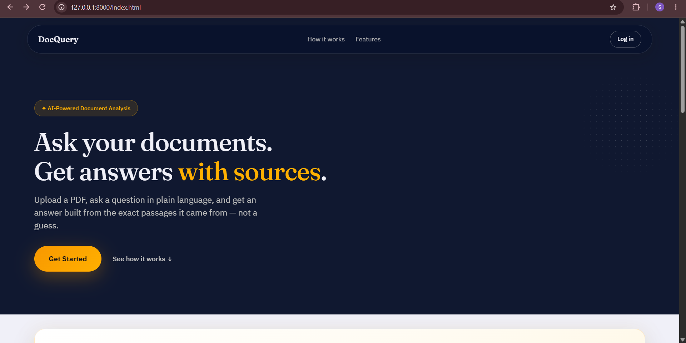
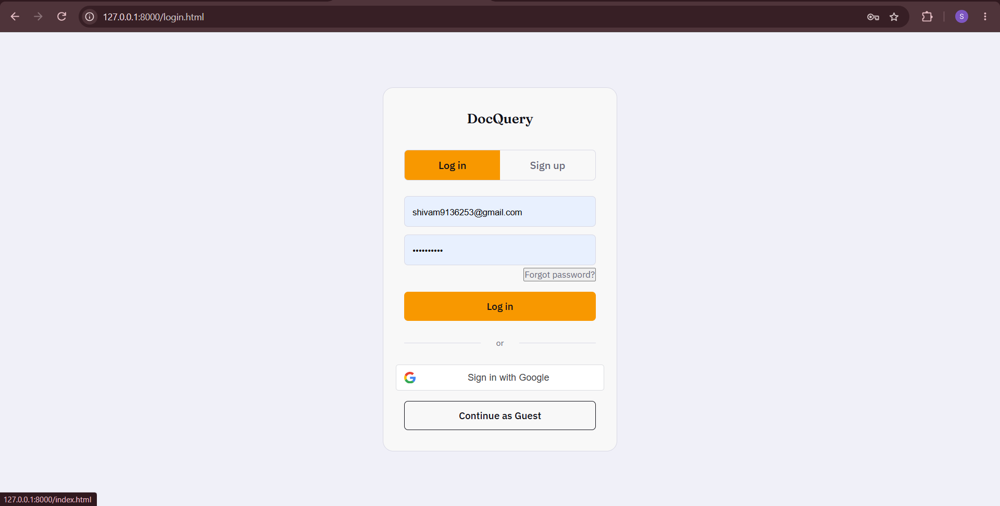
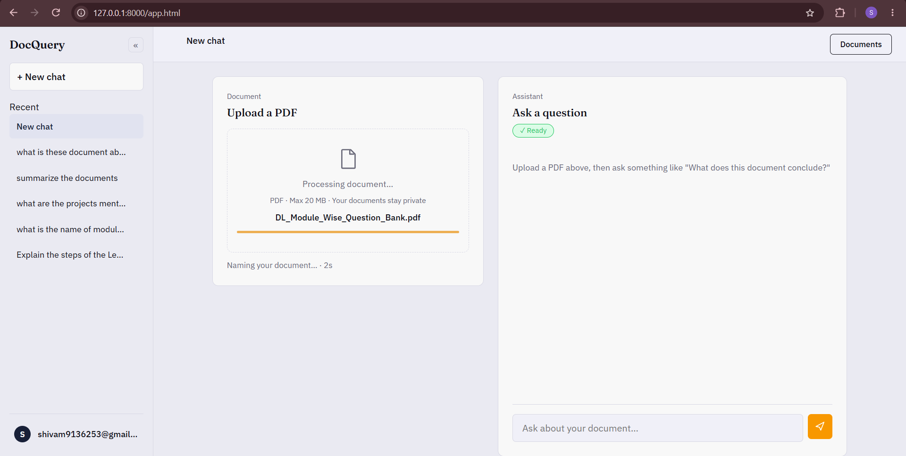
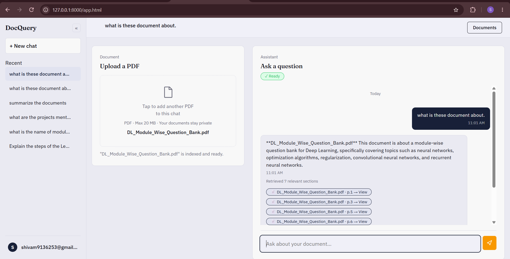
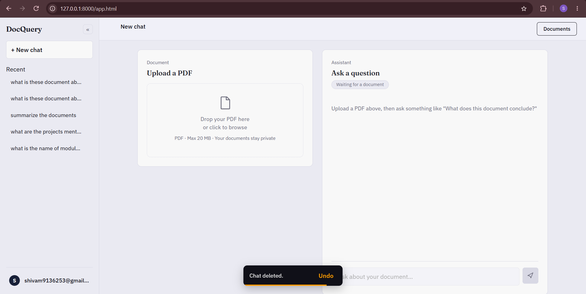
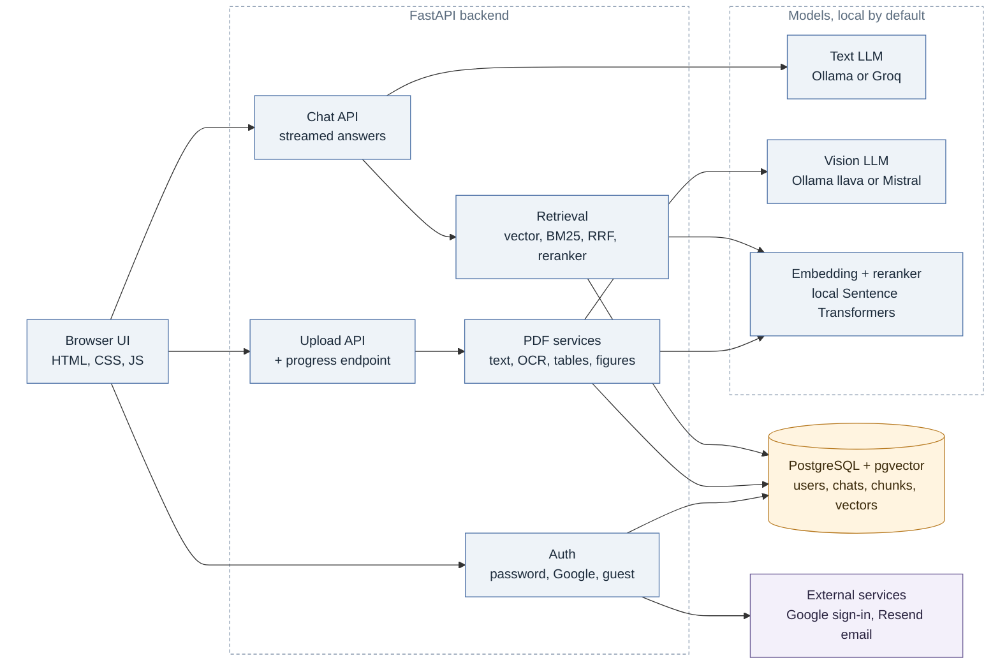
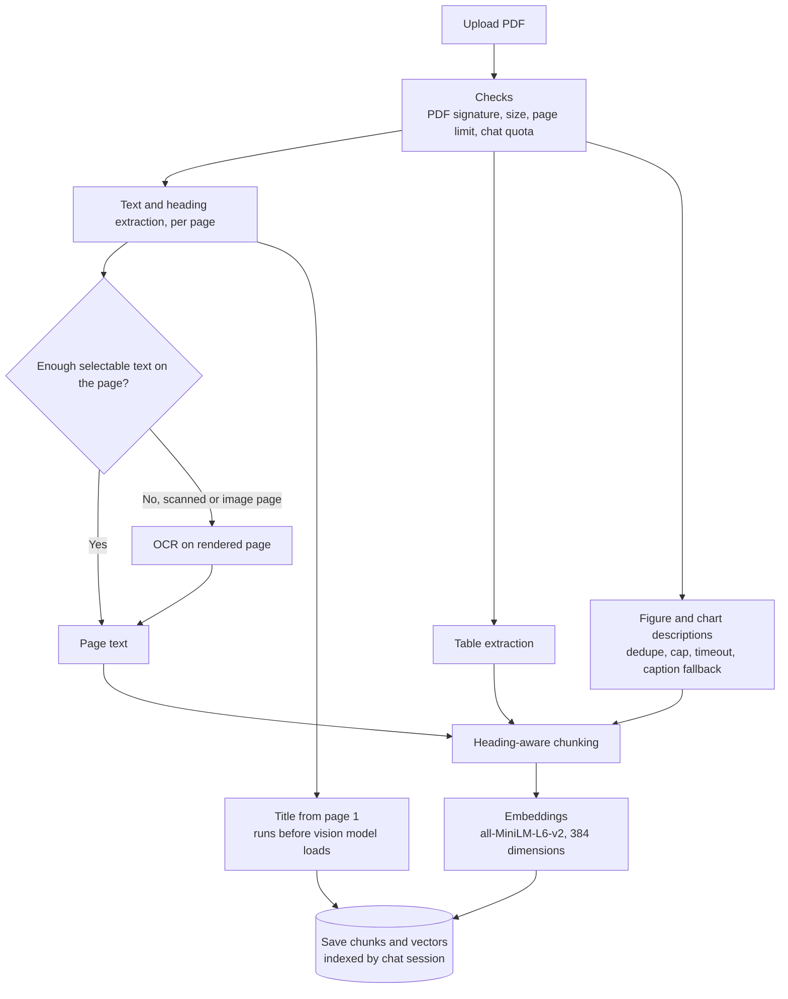
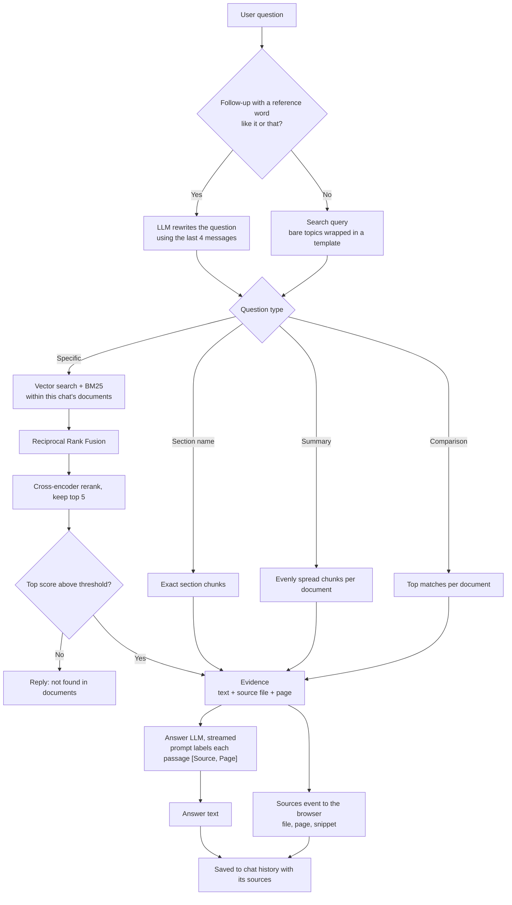

# DocQuery

     

**Ask questions about your PDFs and get answers that cite the exact page.**

DocQuery is a full-stack RAG app. Upload PDFs, ask in plain language, and read a streamed answer with its source file and page. It runs entirely on your machine with Ollama and PostgreSQL. Hosted providers are optional.

| | |
|---|---|
| **Stack** | FastAPI, PostgreSQL + pgvector, Sentence Transformers, cross-encoder reranker, Ollama |
| **Retrieval** | Vector search + BM25, fused with Reciprocal Rank Fusion, then reranked |
| **Result** | **90.0% strict Recall@5** on a 30-question evaluation (dense-only baseline: 76.7%) |
| **Engineering** | Chat-level isolation, streamed answers, figure processing that cannot stall an upload |

## Demo

**Landing page**  : The landing page explains the product and lets visitors start a guest chat or sign in.



**Login**  : Sign in with email and password, with Google, or continue as a guest.



**Upload with live status**  : While a PDF is processed, the status line shows the current stage and a live timer.



**Answer with source pages**  : Each answer lists the file and page of every passage it was built from.



**Chat history and undo**  : Chats are listed in the sidebar. Deleting one shows an Undo option for six seconds before the delete is final.



## Architecture



## How it works

### Ingestion: from PDF to searchable chunks



### Question answering: from question to cited answer



## Key engineering decisions

| Decision | Why | Evidence |
|---|---|---|
| Hybrid search plus reranker | Reranking the merged candidates gave the biggest recall gain | 76.7% → 90.0% strict Recall@5 |
| Dedupe figures before the 20-figure cap | Repeated logos were using up the cap and dropping real figures on later pages | Tested with a synthetic PDF |
| Per-figure timeout, token cap, downscaling | One slow figure cannot block an upload | Tested with simulated timeouts |
| Title generated before the vision model loads | Avoids swapping two models in and out of Ollama | Stage timings in the upload log |
| Plain B-tree index per chat, not HNSW | An approximate index filtered by chat can return fewer than k results | Design choice, documented in `main.py` |
| Full-text hash as fusion key | A key from the first 80 characters can merge two different chunks | Tested with chunks that share a prefix |

## Results

The evaluation uses 30 questions. Each question names the expected source file and page. **Strict** matching counts a hit only if both appear in the top-k results. These are **retrieval** results. They do not measure whether generated answers are correct.

| Setup | Strict Recall@5 | Strict Recall@10 |
|---|---:|---:|
| Dense vector search only | 76.7% | 86.7% |
| Dense + reranker | 86.7% | 90.0% |
| Hybrid (vector + BM25, RRF) | 76.7% | 90.0% |
| **Hybrid + reranker (current)** | **90.0%** | **96.7%** |

Files: [dataset](evaluation/dataset.json), [evaluator](evaluation/run_eval.py), [ingestion script](evaluation/ingest_all.py), [recorded results](evaluation/results_phase7.json).

<details>
<summary>Methodology and caveats</summary>

- **Strict vs keyword matching.** Strict is the primary metric. Keyword matching is a secondary diagnostic only.
- **Hybrid alone did not beat dense at top-5.** Its gain comes from the reranker stage at top-5 and from recall at top-10. At top-5, dense + reranker has a slightly higher strict MRR (0.69 vs 0.68).
- **Small sample.** 30 questions is enough to compare setups, but a difference of one or two questions is within noise.
- **Not answer quality.** Answer correctness is not measured yet.

</details>

## Security

**Implemented and covered by automated tests** (`tests/test_security_and_ocr.py`):

- Guest chats require a credential bound to that chat ID. It is HttpOnly and SameSite=Strict, and it is rejected for any other chat.
- Requests from origins outside the allowlist are rejected.
- The login cookie is HttpOnly, and Secure over HTTPS.
- Uploads are rate-limited (6 per hour per client). The client key is an HMAC, not a raw IP.
- PDFs are limited to 300 pages, and OCR has per-page and per-document pixel budgets.

**Implemented but not covered by automated tests yet:**

- Account chats are checked against the owner, and other accounts get a 403.
- Every retrieval query is filtered by chat session.
- Passwords are hashed with bcrypt. Login locks for 15 minutes after 5 failed attempts.
- Upload progress uses the same authorization check as the upload.

**Secrets.** Settings come from environment variables or a git-ignored `.env` file. The app refuses to start without `DATABASE_URL` and `JWT_SECRET`.

**What leaves your machine.** The default configuration keeps all document content local.

| Feature | Provider | What is sent |
|---|---|---|
| Default (Ollama) | None | Nothing leaves the machine |
| Text generation with Groq | Groq | Questions, retrieved passages, recent messages, page-1 text for the title |
| Figure descriptions with Mistral | Mistral | Figure images and their captions |
| Google sign-in | Google | The sign-in token, verified by the server |
| Password reset and verification | Resend | Email address and the one-time code |

On first run, the embedding and reranker models download from Hugging Face. No document content is sent.

## Quick start

Requirements: Python 3.11+, PostgreSQL with pgvector, Ollama (`ollama pull llama3.2` and `ollama pull llava`), and Tesseract for OCR.

```bash
git clone https://github.com/Shivam7977/privatedoc.git
cd privatedoc
python -m venv .venv && source .venv/bin/activate   # Windows: .venv\Scripts\Activate.ps1
python -m pip install -r requirements.txt
cp .env.example .env        # set DATABASE_URL and JWT_SECRET
uvicorn app.main:app --reload
```

Open [http://localhost:8000](http://localhost:8000). API docs are at `/docs`.

Enable pgvector once in your database with `CREATE EXTENSION IF NOT EXISTS vector;`. The app creates its tables and indexes at startup.

> For large PDFs, run without `--reload`. Saving a Python file restarts the server and cancels any upload in progress.

<details>
<summary>Configuration</summary>

| Variable | Default | Purpose |
|---|---|---|
| `DATABASE_URL` | none | PostgreSQL connection string. Required. |
| `JWT_SECRET` | none | Signs login and guest tokens. Required. |
| `JWT_EXPIRE_MINUTES` | `10080` | Login token lifetime (7 days). |
| `LLM_PROVIDER` | `ollama` | `ollama` or `groq`. |
| `GROQ_API_KEY` | none | Required for `groq`. |
| `VISION_PROVIDER` | `ollama` | `ollama` or `mistral`. |
| `OLLAMA_VISION_MODEL` | `llava` | Vision model for Ollama. |
| `MISTRAL_API_KEY` | none | Required for `mistral`. Install `mistralai` separately. |
| `MISTRAL_VISION_MODEL` | `pixtral-12b-2409` | Vision model for Mistral. |
| `VISION_TIMEOUT_SECONDS` | `90` | Time limit for one figure. |
| `VISION_MAX_OUTPUT_TOKENS` | `200` | Length cap for each figure description. |
| `VISION_MAX_SIDE_PX` | `1024` | Figures are downscaled to this size first. |
| `VISION_KEEP_ALIVE` | `10m` | How long Ollama keeps the vision model loaded. |
| `TESSERACT_CMD` | none | Path to Tesseract, if it is not on `PATH`. |
| `FRONTEND_ORIGIN` | `http://localhost:8000` | Allowed origin(s), comma-separated. |
| `GOOGLE_CLIENT_ID` | none | Enables Google sign-in. |
| `RESEND_API_KEY`, `FROM_EMAIL` | none | Enable email codes. |

</details>

<details>
<summary>Deployment</summary>

The `Dockerfile` installs Tesseract and the Python dependencies, and it reads the port from `PORT`, so it runs on hosts such as Render. Ollama does not run on most free tiers, so a hosted deployment needs `LLM_PROVIDER=groq`. Plan for enough RAM to load the embedding and reranker models.

</details>

<details>
<summary>API</summary>

| Endpoint | Purpose |
|---|---|
| `GET /health` | Health check |
| `POST /auth/signup`, `/auth/login`, `/auth/google`, `/auth/guest` | Sign in or start a guest chat |
| `POST /api/documents/upload` | Upload a PDF to a chat |
| `GET /api/documents/upload/{upload_id}/progress` | Current stage of an upload |
| `POST /chat` | Ask a question; the answer streams as server-sent events |
| `/chats` | List, create, read, rename, delete chats |

</details>


<details>
<summary>Troubleshooting</summary>

- **Upload fails with a database error:** pgvector is not enabled. Run `CREATE EXTENSION IF NOT EXISTS vector;`.
- **Scanned pages come back empty:** Tesseract is missing or not on `PATH`. On Windows, set `TESSERACT_CMD`.
- **Figures are missing from answers:** check the upload log for `[visual_extractor]` and `[vision]` lines. They show which figures were described, skipped, or timed out.
- **Slow uploads on a CPU-only machine:** figure descriptions are the main cost. Lower `VISION_MAX_OUTPUT_TOKENS` or `VISION_MAX_SIDE_PX`, or use `VISION_PROVIDER=mistral`. The `stage durations` log line shows where time goes.

</details>

<details>
<summary>Limits and known gaps</summary>

- 20 MB per PDF, 50 MB per chat, 300 pages per PDF, and up to 20 unique figures described per document.
- No end-to-end processing deadline. Upload time depends on the document, hardware, and providers.
- Upload progress is held in memory, so it works with one server process.
- Equations are indexed as text, not converted to LaTeX.
- Answer quality is not yet evaluated. Only retrieval is measured.

</details>

## Project Structure

```
privatedoc/
├── app/
│   ├── api/
│   │   ├── auth.py                # Signup, login, Google sign-in, guest access
│   │   ├── chat.py                # Streamed question answering (/chat)
│   │   ├── chats.py               # Chat list, rename, delete
│   │   ├── deps.py                # Auth and chat-ownership checks
│   │   └── documents.py           # PDF upload and progress endpoint
│   ├── db/
│   │   ├── database.py            # Engine and session setup
│   │   └── models.py              # Users, chats, messages, chunks, documents
│   ├── schemas/                   # Request and response models
│   ├── services/
│   │   ├── pdf_parser.py          # Text, headings, OCR fallback
│   │   ├── table_extractor.py     # Table detection
│   │   ├── visual_extractor.py    # Figures and charts
│   │   ├── vision_provider.py     # Ollama or Mistral figure descriptions
│   │   ├── caption_utils.py       # Caption detection for figures
│   │   ├── title_extractor.py     # Document title
│   │   ├── chunker.py             # Heading-aware chunking
│   │   ├── embeddings.py          # Sentence-transformer embeddings
│   │   ├── vector_store.py        # pgvector storage and search
│   │   ├── bm25_retriever.py      # Keyword search
│   │   ├── hybrid_retriever.py    # Vector + BM25 fusion (RRF)
│   │   ├── reranker.py            # Cross-encoder reranking
│   │   ├── query_classifier.py    # Specific, section, summary, comparison
│   │   ├── retriever.py           # Retrieval per question type
│   │   ├── llm.py                 # Text generation and query rewriting
│   │   ├── security.py            # Password hashing and tokens
│   │   ├── rate_limit.py          # Upload rate limit
│   │   ├── email.py               # Verification and reset emails
│   │   └── cleanup.py             # Stale guest chat cleanup
│   ├── config.py                  # Settings and limits
│   └── main.py                    # App setup, headers, startup tasks
├── frontend/
│   ├── index.html                 # Landing page
│   ├── login.html, login.js       # Sign-in page
│   ├── app.html, app.js           # Chat interface
│   └── styles.css
├── evaluation/
│   ├── dataset.json               # 30 questions with expected source and page
│   ├── ingest_all.py              # Loads evaluation documents
│   ├── run_eval.py                # Retrieval evaluator
│   └── results_phase7.json        # Recorded results
├── tests/
│   └── test_security_and_ocr.py   # Security, OCR, and limit tests
├── check_chunks.py                # Manual helper for answer generation
├── Dockerfile
├── requirements.txt
├── .env.example
└── README.md
```

## License

MIT. See [LICENSE](LICENSE).